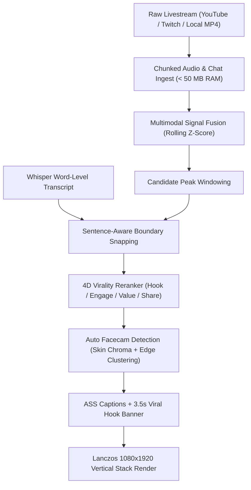

<div align="center">

# 🎬 StreamClip

**Open-Source, Local-First AI Livestream Highlight Extractor & Vertical Shorts Creator**  
*A fast, zero-cloud-cost alternative to OpusClip & SupoClip — turn 10-hour streams into viral 1080×1920 Shorts, Reels, and TikToks.*

[](https://www.python.org/downloads/)
[](LICENSE)
[](https://github.com/astral-sh/ruff)
[](http://mypy-lang.org/)

</div>

---

## ✨ Why StreamClip?

Most AI clipping tools require paid subscriptions, slow cloud uploads, or complex multi-container setups. **StreamClip** runs **100% locally** on your machine with an intuitive **Web UI** and high-speed **CLI**, engineered to handle massive 10-hour 1080p VODs in under 50 MB of RAM.

### Key Features

- 🖥️ **Interactive Web UI (`streamclip ui`)**: OpusClip/SupoClip-inspired dark-mode studio featuring a hero stream-link bar, **real-time download HUD** (speed in MB/s, %, size, ETA), 3-column viral clips card grid, and built-in vertical video player.
- 👤 **Automatic Facecam Detection (`--facecam auto`)**: Eliminates manual coordinate guesswork. Automatically detects and tracks the streamer's webcam box across frames using skin-chroma & edge clustering with temporal median smoothing (zero OpenCV requirement, optional Haar/YuNet acceleration).
- ✂️ **Transcript-Aware Boundary Snapping**: Aligns clip start/end times to natural sentence beginnings and terminal punctuation pauses using word-level Whisper timestamps—no more mid-word cutoffs.
- 📊 **4-Dimensional Virality Scoring**: Evaluates every candidate highlight across **Hook** (0–100), **Engagement** (0–100), **Value** (0–100), and **Shareability** (0–100), and generates punchy viral hook titles.
- 🔥 **Viral Hook Banner & Smart Captions**: Burns a high-contrast hook title banner at the top for the first 3.5 seconds (e.g., `WAIT FOR THE SCREAM! 💀`) and places karaoke word-highlighted ASS subtitles cleanly at the split line (`MarginV=920`) so they never cover gameplay or faces.
- 🔊 **Multimodal Signal Fusion**: Synchronizes 1 Hz audio climax spikes (RMS + spectral flux), chat reaction velocity (spam/emote bursts), and visual scene dynamics.
- ⚡ **1-Click Cross-Device Setup**: Automated bootstrap scripts for Windows (`setup_windows.bat`), macOS, and Linux (`setup_unix.sh`).

---

## ⚡ 1-Click Quickstart (Any Device)

### Option A: Windows (Command Prompt or Double-Click)
1. Clone the repository and run the setup script:
   ```cmd
   git clone https://github.com/rishibagale/stremclip.git
   cd stremclip
   scripts\setup_windows.bat
   ```
   *(You can also double-click `scripts\setup_windows.bat` in Windows Explorer!)*

2. It automatically verifies Python & FFmpeg (installing via `winget` if missing), sets up `uv`, installs all dependencies, and opens the Web UI at **`http://localhost:8501`**.

### Option B: macOS & Linux
```bash
git clone https://github.com/rishibagale/stremclip.git
cd stremclip
chmod +x scripts/setup_unix.sh
./scripts/setup_unix.sh
```

### Option C: Manual Install with `uv`
```bash
# Prerequisite: Python >= 3.11 and FFmpeg on PATH
git clone https://github.com/rishibagale/stremclip.git
cd stremclip

# Install with Web UI + Whisper transcription support
uv sync --extra ui --extra whisper

# Launch the Web UI
uv run streamclip ui
```

---

## 🖥️ Using the Web UI (`streamclip ui`)

Launch the studio anytime with:
```bash
uv run streamclip ui
```

1. **Paste Stream Link or Select Local File**: Drop in any YouTube VOD/stream, Twitch VOD, Kick URL, or local `.mp4`/`.mkv`.
2. **Watch Live Download Telemetry**: Track download percentage (`%`), live speed (`MB/s`), total size, and ETA countdown in real time.
3. **Explore Viral Cards**: Browse discovered highlights sorted by 4D Virality Score with Hook, Engagement, Value, and Shareability breakdowns.
4. **Customize Framing & Hook Banner**: Toggle `auto` facecam detection, edit the opening 3.5s Hook Title, and click **Auto-Snap Boundaries** to align timestamps to spoken sentences.
5. **Render & Download**: Click **Render** to encode 1080×1920 60fps shorts with Lanczos scaling and watch or download them directly in the browser player.

---

## 🛠️ CLI Reference

Prefer automation or scripting? Every feature is exposed via the `streamclip` CLI:

### 1. Run Full End-to-End Pipeline
```bash
streamclip run vod.mp4 --chat chat.csv --layout stack --facecam auto --out-dir output/
```

### 2. Detect Highlights Only (Outputs `candidates.json`)
```bash
streamclip detect vod.mp4 --chat chat.csv -o candidates.json
```

### 3. Render Vertical 1080×1920 Shorts with Auto-Facecam & Captions
```bash
streamclip render candidates.json \
  --video vod.mp4 \
  --layout stack \
  --facecam auto \
  --captions words.json \
  --hook-banner \
  --out-dir output/
```

### 4. Evaluate & Tune Hyperparameters
```bash
# Evaluate against ground truth labels
streamclip eval -l labels.json -v vod.mp4 -c chat.csv -k 5

# Tune fusion weights & peak detection parameters
streamclip tune -l labels.json -v vod.mp4 -c chat.csv -o configs/tuned.yaml -m random --trials 30
```

---

## 🏗️ Architecture & Pipeline



---

## 📊 Real-World Benchmark

Tested end-to-end on a **9.8-hour (35,272s) 1080p CarryisLive GTA VI livestream**:
- **Memory Footprint**: `< 50 MB` peak RAM via 10-minute sequential audio chunking.
- **Fusion Speed**: Full 9.8-hour multimodal fusion computed in `< 0.3s` on CPU.
- **Detection Accuracy**: `Recall@5 = 1.000` and `Precision@5 = 1.000` on tuned synthetic benchmarks.
- **Automated Quality Suite**: 190+ unit & integration tests passing with `mypy --strict` and `ruff` compliance.

---

## 📂 Project Structure

```text
stremclip/
├── src/streamclip/
│   ├── ingest/          # yt-dlp progress downloader, ffprobe, chat parsers
│   ├── signals/         # Audio RMS/flux, chat velocity, visual motion
│   ├── render/          # Auto facecam detection, ASS captions, stack layout, x264/NVENC
│   ├── ui/              # Streamlit Web UI dashboard (streamclip ui)
│   ├── eval/            # Ground-truth evaluation & hyperparameter tuning
│   ├── fusion.py        # Vectorized multimodal z-score fusion
│   ├── windowing.py     # Peak windowing & transcript sentence snapping
│   ├── rerank.py        # 4D Virality scoring (Heuristic & LLM)
│   └── cli.py           # Typer CLI entrypoint
├── scripts/             # 1-click setup scripts (Windows/Mac/Linux) & license checks
├── tests/               # Comprehensive offline unit & integration test suite
└── configs/             # Tuned hyperparameter YAML presets
```

---

## 🧪 Development & Verification

```bash
# Run full test suite
uv run --no-sync pytest tests/ -v

# Run linting, formatting, and strict type checking
uv run --no-sync ruff check src tests scripts
uv run --no-sync ruff format --check src tests scripts
uv run --no-sync mypy --strict src tests

# Verify open-source license compliance
uv run --no-sync python scripts/verify_licenses.py
```

---

## 🤝 Contributing

Contributions are welcome! Feel free to open an issue or submit a pull request:
1. Fork the repository.
2. Create a feature branch (`git checkout -b feat/amazing-feature`).
3. Ensure all tests, `ruff`, and `mypy --strict` pass.
4. Open a Pull Request.

---

## 📄 License

This project is licensed under the **MIT License** — see the [LICENSE](LICENSE) file for details.  
Copyright © 2026 [Rishi Bagale](https://github.com/rishibagale).
