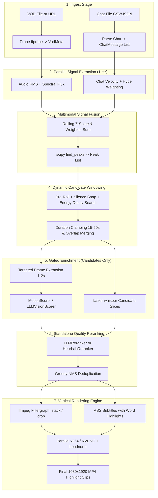

# streamclip Architecture Reference

## Overview

`streamclip` is an offline-first, multimodal livestream highlight extractor designed to convert multi-hour livestream broadcasts (such as Grand Theft Auto VI streams) into viral vertical 1080x1920 clips for TikTok, YouTube Shorts, and Instagram Reels.

Unlike speech-centric clipping tools that rely exclusively on automatic speech recognition (ASR) transcripts, `streamclip` prioritizes **chat spikes**, **sudden audio volume/frequency bursts**, and **visual action changes**.

---

## High-Level Pipeline Architecture

The end-to-end extraction pipeline follows a unidirectional, modular flow:

---

## Core Domain Models (`src/streamclip/models.py`)

All cross-module interactions rely strictly on frozen Pydantic domain models:

1. **`VodMeta`**: Describes VOD resolution, framerate, duration, and audio channel presence. Exposes `expected_signal_length` ($\lceil \text{duration\_s} \rceil$).
2. **`ChatMessage`**: A normalized chat replay message ($t$ in seconds from stream start, username, body, and extracted emote tokens).
3. **`SignalTrack`**: A 1 Hz timeseries containing one raw float per second of media. Always length $\lceil \text{duration\_s} \rceil$.
4. **`Candidate`**: A candidate highlight interval bounded by `start`, `end`, and centered on `peak_t`, with component score attribution.
5. **`Word`**: Timed word segment (`start`, `end`, `text`) for subtitle highlighting.
6. **`RankedClip`**: Evaluated highlight candidate with `final_score`, generated title, and editorial reasoning.
7. **`RenderSpec`**: Concrete rendering instructions containing target layout (`stack`, `gameplay_only`, `facecam_only`), facecam bounding box, and subtitle styling.

---

## Multimodal Fusion & Vectorized Processing

Fusion converts unnormalized, disparate signals into a unified highlight likelihood score:
1. **Rolling Baseline Z-Score**: Computes rolling mean and standard deviation (or robust rolling median and MAD) over a configurable window (default 60s).
2. **Confidence Scaling**: Signals with low activity (e.g. low chat message volume) carry an `activity_confidence` metric in `SignalTrack.meta` that scales their weight down automatically.
3. **Gaussian Smoothing**: Applies 1D Gaussian filtering to avoid jittery single-second trigger spikes.
4. **Scipy Peak Detection**: Calls `scipy.signal.find_peaks` with `peak_height` and `min_peak_gap_s` to identify candidate climax points.

> [!NOTE]
> All signal fusion routines are fully vectorized with NumPy and SciPy. An 8-hour VOD track (28,800 points) is processed in under 0.3 seconds on a standard CPU.

---

## Resumability & Disk Caching

Every expensive computation is cached on disk via `DiskCache` (`src/streamclip/cache.py`):
- Keyed by `sha256(source_file_content)` + `sha256(config_slice)`.
- Caches raw signal arrays (`audio.json`, `chat.json`), transcription word segments, visual scores, and final rendered videos.
- Re-running the pipeline on an existing VOD completes instantaneously without repeating audio decoding or LLM API calls.

---

## Graceful Degradation Paths

The pipeline never crashes when optional inputs or dependencies are missing:
- **No Chat Replay**: Emits an all-zero `SignalTrack` with `meta={"empty": True, "activity_confidence": 0.0}`. Fusion redistributes weight to audio and vision.
- **No Audio Stream**: `extract_audio_signal` yields a zero track and marks silence points across the VOD. Subtitles and audio-dependent snapping are bypassed.
- **No Anthropic API Key**: `pipeline.py` automatically falls back to `HeuristicReranker` and `MotionScorer` without prompting or failing.
- **No NVENC Hardware**: Hardware acceleration automatically degrades to CPU-based `libx264` encoding.
- **Missing `faster-whisper`**: Rendering continues cleanly without burning in word-highlighted captions.
